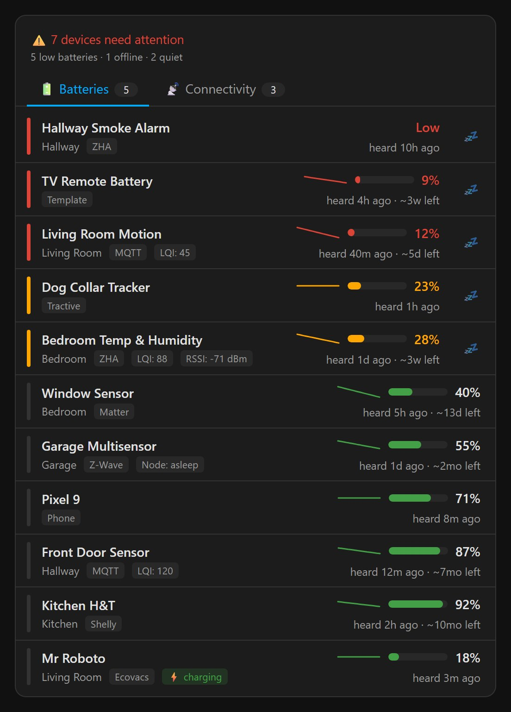
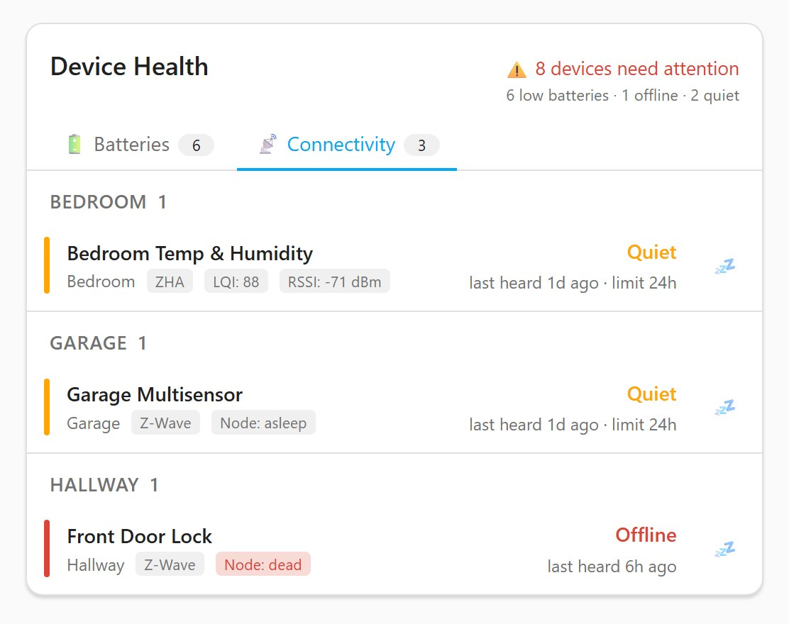
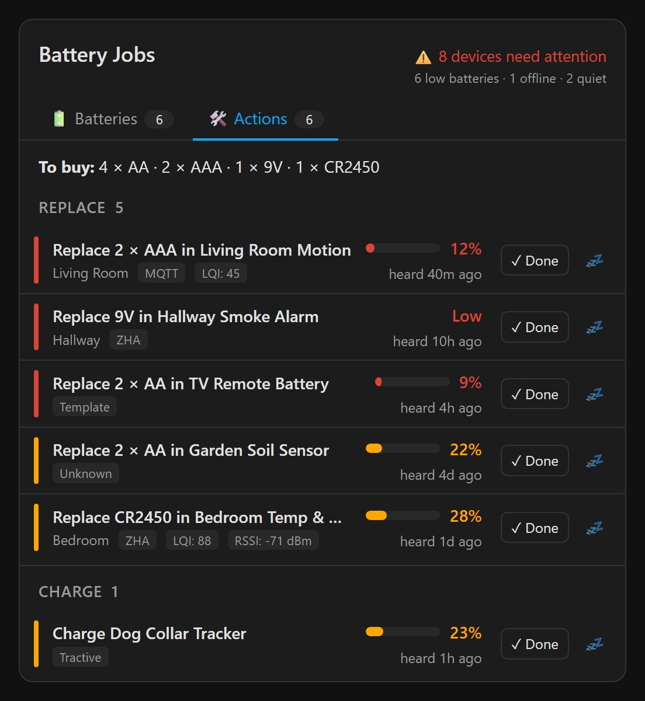

# Pulse Check

A [Home Assistant](https://www.home-assistant.io/) integration that watches every device's **battery** and **connectivity** across all your integrations, and tells you what to do about it.

It brings entities, notifications, services, a blueprint and a **dashboard card**. One install provides all of them: the integration serves the card itself and adds it to your dashboards, so it simply appears in the card picker.

<p align="center">
  
  
  
</p>

<p align="center"><em>The card's Batteries, Connectivity and Actions tabs, rendered from its demo page with mock data.</em></p>

[](https://github.com/yog18r/pulse-check-integration/actions/workflows/ci.yml)

> **Status: feature complete, lightly tested.** Everything in the [plan](https://github.com/yog18r/pulse-check-integration/blob/main/PLAN.md) is built: detection rules, entities, options, notifications, services, replacement tracking and the card. It has run on one real instance. Expect rough edges; issues are welcome. See [Roadmap](#roadmap).

---

## The problem

Devices quietly drop off. A door sensor's coin cell dies on a Tuesday and you find out three weeks later when an automation never fires. A Z-Wave node goes dead after a power blip. A Wi-Fi plug loses its connection and sits there reporting its last known state forever.

Home Assistant has all the data to spot this, but it is spread across hundreds of entities, and Home Assistant's own low-battery alerts only cover devices that expose a battery sensor the standard way. Pulse Check pulls it together:

- **Low batteries** from percentage sensors, binary "low battery" sensors, and `battery_level` attributes alike, with charging devices never flagged
- **Offline** devices: every primary entity unavailable
- **Unavailable** services and entities with no device: AdGuard Home or Sun dropping out, a template sensor whose source broke, an automation that failed to load
- **Quiet** devices: no report within a threshold, judged per device and per integration
- **Actions**: "Replace 2 × AA in Kitchen Mini Switch", "Charge Office Tablet", and a to-buy total per battery type
- **Notifications** once per transition, not once per update: a device goes offline, goes quiet, or drops to warning or critical. Instant with reminders, or collected into a daily or weekly digest, chosen per device. A limit per integration keeps an outage to a few messages, failed sends are retried, and a broken notify target shows up under Repairs
- **Days left** from the recorder's history (hours for a battery charged every day, with the level it usually falls to), **replacement tracking** with cycle statistics, and a flag when a battery drains much faster than it used to
- **Snooze** a device for a while; snoozes are shared across every browser and user
- Everything grouped by **device**, not entity, so each physical thing appears once
- In **ten languages**: English, German, French, Spanish, Dutch, Italian, Brazilian Portuguese, Polish, Simplified Chinese and Czech

It reads only what Home Assistant already knows: the state machine and the registries. **It never contacts a device**, so it cannot wake or drain anything.

<!-- ha-marketplace:exclude-start -->
## Installation

[](https://my.home-assistant.io/redirect/marketplace_repository/?owner=yog18r&repository=pulse-check-integration&category=integration)

Requires Home Assistant 2026.9 or newer.

### Option 1: the Marketplace (Home Assistant 2026.11 and newer)

Since 2026.11, community integrations install from **Settings → Marketplace**, which replaced HACS. Select the button above, or add the repository by hand:

1. Go to **Settings → Marketplace**.
2. In the upper-right corner, select **Add from link**.
3. Enter `yog18r/pulse-check-integration` and select **Add**.
4. Open **Pulse Check**, select **Install**, and restart Home Assistant.

Adding from a link needs the Marketplace's GitHub connection, which it asks you to set up the first time. Pulse Check is not in the Marketplace catalog yet; once it is, you can find it by searching under **Settings → Marketplace** instead.

### Option 2: HACS (Home Assistant 2026.9 and 2026.10)

HACS still works on versions before 2026.11. Add `https://github.com/yog18r/pulse-check-integration` as a custom repository in HACS (category: Integration), install it and restart Home Assistant. When you move to 2026.11, Home Assistant carries it over to the Marketplace.

### Option 3: manual

Download `pulse_check.zip` from the [latest release](https://github.com/yog18r/pulse-check-integration/releases/latest), unzip it into `config/custom_components/pulse_check/` and restart. The zip already contains the card.

Copying `custom_components/pulse_check` from a checkout of this repository works too, but build the card into it first (it is not committed):

```bash
cd frontend
npm ci
npm run build
```

That writes `custom_components/pulse_check/frontend/pulse-check-card.js`. Delete any `__pycache__` folders before copying; some file-manager add-ons refuse to upload `.pyc` files. The release zip never contains them.
<!-- ha-marketplace:exclude-end -->

## Setting up

Go to **Settings → Devices & services → Add integration** and search for **Pulse Check**. There is nothing to fill in. One instance watches the whole house.

Refresh the browser, edit a dashboard, **Add card**, and pick **Pulse Check Card**, or add it in YAML:

```yaml
type: custom:pulse-check-card
```

### How the card gets onto your dashboards

A *dashboard resource* (Settings → Dashboards → ⋮ → Resources) is a script every dashboard loads. On each start the integration serves its card at `/pulse_check/pulse-check-card.js` and makes sure there is exactly one resource for it, of type *JavaScript module*, with the integration's version on the end (`?v=0.2.10`). After an update the version changes, the resource is updated with it, and browsers fetch the new card instead of a cached old one. Removing the integration removes the resource.

If your resources are defined in YAML (`lovelace: resource_mode: yaml`), an integration must not edit them, so Pulse Check logs the line to add instead:

```yaml
lovelace:
  resources:
    - url: /pulse_check/pulse-check-card.js?v=0.2.10
      type: module
```

## Languages

Pulse Check speaks English, German (`de`), French (`fr`), Spanish (`es`), Dutch (`nl`), Italian (`it`), Brazilian Portuguese (`pt-BR`), Polish (`pl`), Simplified Chinese (`zh-Hans`) and Czech (`cs`), in three places:

- **Dialogs, entity names and services** follow each user's language, like any integration (`custom_components/pulse_check/translations/`).
- **Notifications and digests** are written in the server language (Settings → System → General), checked as each message is sent, so a change needs no restart (`custom_components/pulse_check/messages/`).
- **The card and its editor** follow each user's profile language, including dates and "5m ago" style times (`frontend/src/i18n/`).

A regional variant uses its base language (`de-CH` reads German, `pt` reads Brazilian Portuguese) and anything else reads English. A few things stay as they are everywhere: device and area names, battery sizes such as CR2032, and YAML keys in the card's error messages.

> **The translations were made by machine.** They have been checked for completeness and placeholders, not by native speakers. Corrections are very welcome: each language is one file in each of the three folders above, so a pull request that fixes a phrase touches only that line.

## Options

Open **Settings → Devices & services → Pulse Check → Configure** and choose **Thresholds, filters and notifications** for the options below, or **Per-device settings** for one device. Everything has a sensible default; the first thing most people change is the filters.

**Thresholds**

| Option | Default | Meaning |
| --- | --- | --- |
| Battery warning level | 30 % | At or below this a battery is a warning |
| Battery critical level | 15 % | At or below this a battery is critical |
| Quiet after | 24 h | Hours without any report before a device is quiet |
| Which devices can be quiet | Battery devices only | "All devices" judges mains devices too; expect noise from lights and media players |
| Quiet threshold per integration | none | Longer thresholds for integrations whose devices report rarely, e.g. `zwave_js` 48 h, blinds 48 h |

**Filters**

| Option | Meaning |
| --- | --- |
| Watch services and entities with no device | On by default. Services (Sun, AdGuard Home, Backup) and entities with no device (template sensors, automations, helpers) count as unavailable when they stop working. Off, a lone entity is watched for its battery only. See [How detection works](#how-detection-works) |
| Only these areas / Ignore these areas | Area allow and deny lists. With an allow list, devices without an area are left out |
| Only these integrations / Ignore these integrations | By platform, e.g. `mobile_app` to leave phones out, `music_assistant` for players that are off when the TV is |
| Ignore these devices | Specific devices |
| Ignore these entities | Specific entities: typically a settings sensor an integration labels `device_class: battery` (an inverter's "minimum state of charge") without marking it as a config entity |

The option keys match the card's YAML (`battery_warning`, `exclude_entities`, `integration_thresholds`, …), so a card config translates one to one.

**Notifications** (collapsed by default)

| Option | Default | Meaning |
| --- | --- | --- |
| Send to | none | Notify services (`notify.mobile_app_…`) or notify entities. Empty means no notifications; the event still fires |
| Critical problems | Instantly | Default delivery for offline devices and critical batteries |
| Warnings | Weekly digest | Default delivery for quiet devices and low batteries |
| Remind after | 3 days | How long an instant notification may stay unresolved before it is sent again |
| Reminders at most | 3 | 0 turns reminders off |
| Offline and quiet messages per integration | 3 | At most this many offline or quiet messages per integration in an hour; the rest follow as one message. 0 means no limit. See [Outages](#outages) |
| Digest time | 09:00 | When the daily digest goes out, and the weekly one on its day. One missed while Home Assistant was off goes out once after the next start |
| Weekly digest day | Monday | |
| Weekly "all clear" | off | Send the weekly digest even when there is nothing to report |
| Quiet period after start | 5 min | Nothing is judged until Home Assistant has started plus this long. Integrations load one by one and most devices look unavailable meanwhile; what is still wrong at the end is recorded as the starting point, not announced |
| Confirm offline or quiet after | 5 min | An offline or quiet state must persist this long before it counts. A missed poll that heals within the window sends nothing. Battery levels count at once |
| Offline if not back after a restart | 30 min | Minutes after the start. A device not seen working by then counts as offline, "offline since the restart", so one that died while Home Assistant was off is still reported. Never earlier than a minute after the quiet period. 0 waits for ever |
| Maintenance mode length | 2 h | How long `pulse_check.maintenance_mode` holds notifications back when it is called without `hours` |

A device's own notification policy (under **Per-device settings**, or the `set_device_settings` service) overrides the defaults: `instant`, `daily`, `weekly` or `none`. A leak detector can be instant while the blinds wait for the weekly digest.

**Entities** (collapsed by default)

| Option | Default | Meaning |
| --- | --- | --- |
| Per-device battery sensors | off | Adds "Battery days left" and "Battery last replaced" diagnostic sensors to every battery device's own page |

### Per-device settings

**Configure → Per-device settings** opens with a list of every device that has saved settings or is ignored, and what they are, such as "Kitchen H&T: 2 × CR2032 · quiet after 48 h · weekly digest". **Edit saved settings** picks one of those; **Add settings for a device** picks any device, service (such as Sun) or entity with no device that has none yet. The form opens with what Pulse Check sees now and what an empty field falls back to ("Battery 54 % · gets charged. Empty fields use: warning at 30 % and critical at 15 %, quiet after 48 h"), then:

| Setting | Meaning |
| --- | --- |
| Display name, Area | Shown on the card and in notifications instead of the device's own. Renaming the device in Home Assistant is usually better; these are for entities Home Assistant cannot rename |
| Battery type, Battery count | For the shopping list on the Actions tab |
| Charged or replaced | Pulse Check works this out from the battery's history (see [Days left](#how-detection-works)). Choose **Charged** or **Replaced** when it gets it wrong: the Actions tab ("Charge" or "Replace"), the notification buttons and the estimates follow it |
| Battery warning level, Battery critical level | This device's own levels instead of the general ones: a phone charged every night can warn at 10 % and be critical at 5 % instead of sending a critical message every evening. Critical may not be above warning |
| Quiet after, Notifications, Trend days | Its quiet threshold, notification policy and the days its trend line shows |
| Ignore this device | Leaves it out of Pulse Check altogether, the same as **Ignore these devices** in the general options (an entity with no device goes on **Ignore these entities**). It takes effect at once, without a reload, and the device stays in the list so it can be taken back |

Leave a field empty for the default; **Remove all settings for this device** clears them all. Saving returns to the list for the next device; **Done** closes the dialog. The settings are stored by the integration, not in any card, so every card on every dashboard and every notification uses them, and saving them does not reload Pulse Check.

Settings saved for something that is no longer found are listed with ⚠, so they can be edited away. When an entity saved by its own id is later given a device by its integration, its settings, snooze and replacement history move to that device, unless the device has settings of its own. The `pulse_check.set_device_settings` action does the same from an automation.

## The card

- **🔋 Batteries**: every battery-powered device, lowest first (or soonest to run out), with a coloured bar, a trend sparkline, "~12d left" (for a battery charged every day, "charge in ~6h · usually lowest 24%", or just "usually lowest 47%" when it never runs down to the warning level, like a home battery topped up by solar), and a note when a battery is draining much faster than it used to
- **📡 Connectivity**: anything offline, not heard from within its threshold, or no longer provided by its integration, and services or entities with no device that have stopped working (shown as *Unavailable*)
- **🛠️ Actions** (optional tab): "Replace 2 × AA in Kitchen Mini Switch", "Charge Office Tablet", a to-buy total, and a **Done** button that records the replacement. For ten seconds afterwards an **Undo** takes a mistaken tap back
- **Snooze** a device for 1, 7 or 30 days. Snoozes live in the integration, so every dashboard, phone and notification agrees
- **Group by** area, integration or device type. Tap a row to open the device in Home Assistant
- A line under the header while **maintenance mode** holds notifications back, with its end time
- A **Refresh** prompt after Pulse Check is updated, since a browser tab keeps running the card it loaded
- A short notice when a snooze, Done or Undo fails (the integration reloading, or no permission), and a warning when the data shown is more than 15 minutes old

The card shows what the integration computed; it analyses nothing itself. What counts as low, how long a device may stay quiet, which devices are ignored and which notifications go out are the integration's options (above). The card's own options are about presentation only, and the visual editor covers all of them:

```yaml
type: custom:pulse-check-card
title: Device Health # leave out for no title row
show_tabs: [batteries, connectivity, actions]
default_tab: batteries
max_rows: 12 # or "all"
sort: level # level, name or replace_soon
group_by: none # none, area, integration or device_type
areas: [] # view filters: names or ids; empty means all
integrations: []
device_types: []
problems_only: false # Batteries tab shows only warning/critical rows
show_sparklines: true
sparkline_days: 14 # 1 to 365
```

| Option | Default | Notes |
| --- | --- | --- |
| `title` | none | Leave out (or blank) for no title row |
| `show_tabs` | `[batteries, connectivity]` | Any of `batteries`, `connectivity`, `actions` |
| `default_tab` | `batteries` | Must be in `show_tabs` |
| `max_rows` | `12` | Or `all`. A "show more" control reveals the rest |
| `sort` | `level` | Inside each severity band: `level` (lowest first), `name`, or `replace_soon`, "Soonest to replace first" (batteries with a replacement estimate first, fewest days left first, then the rest by level; charge estimates do not count). `battery_sort` still works, and the visual editor switches it to `sort` |
| `group_by` | `none` | `none`, `area`, `integration` or `device_type` |
| `areas`, `integrations`, `device_types` | `[]` | Show only these. Device types: `lock`, `cover`, `vacuum`, `phone`, `media`, `remote`, `climate`, `motion`, `contact`, `light`, `switch`, `other` |
| `problems_only` | `false` | Batteries tab shows only warning and critical rows |
| `show_sparklines` | `true` | Trend lines from recorder history, read by the integration |
| `sparkline_days` | `14` | 1 to 365. A device's own sparkline window overrides it |

The integration's filters decide what is monitored at all; a card's `areas`, `integrations` and `device_types` only decide what *that* card shows, so one integration can feed a hallway card, a locks-only card and a whole-house card. The header counts follow the card's filters.

Per-device settings (display name, battery type, notification policy and so on) are not card options: they belong to the integration and apply to every card. The visual editor links to them with **Open Pulse Check settings**; see [Per-device settings](#per-device-settings).

The YAML in the code editor holds only what differs from the defaults: an untouched option, or every area, integration and device type still ticked, is left out.

## Entities

| Entity | State | Attributes |
| --- | --- | --- |
| `sensor.pulse_check_attention` | Number of devices that need attention (warning or critical) | `summary`: the counts below as one mapping; `shopping`: the batteries to buy, a list of `{batteryType, count, devices}`. Neither is kept in the recorder. The device list itself is served over the websocket (see below), not as an attribute |
| `sensor.pulse_check_low_batteries` | Battery devices at or below the warning level, or reporting "low" | |
| `sensor.pulse_check_critical_batteries` | Battery devices at or below the critical level, or reporting "low" | |
| `sensor.pulse_check_offline` | Devices with every primary entity unavailable, and services or entities with no device that are unavailable | |
| `sensor.pulse_check_quiet` | Devices not heard from within their threshold | |
| `sensor.pulse_check_next_to_replace` | *Next to replace*: the replaceable battery with the fewest days left, "more than a year" included, the lower level first on a tie (`unknown` until there is enough history). Batteries that get charged are left out. Installs from before 0.2.11 keep the entity id `sensor.pulse_check_next_to_run_out` | `days_left`, `more_than_a_year`, `device_id`, `entity_id`, `level` |
| `binary_sensor.pulse_check_problem` | On when anything needs attention | |
| `switch.pulse_check_maintenance_mode` | On while maintenance mode holds notifications back. Turn it on to start a window of the default length, off to end it now | `until`: when it ends |

Snoozed devices count in nothing. With the per-device option on, every battery device also gets `sensor.<device>_battery_days_left` and `sensor.<device>_battery_last_replaced` (diagnostic), the latter with the device's cycle statistics as attributes.

## Websocket API

This is the contract between the integration and the card. The card, or anything else on Home Assistant's websocket, can subscribe to the computed data instead of polling entities. Keeping the device list off the sensor's attributes keeps the state machine and the recorder free of a large, frequently changing payload.

**`pulse_check/subscribe`** sends one event immediately and another after every recompute (about ten seconds after a relevant state change, and at least every five minutes):

```json
{
  "devices": [ ...one entry per device, see below... ],
  "summary": { "attention": 4, "critical": 2, "warning": 2, "batteryDevices": 11, "lowBatteries": 4, "criticalBatteries": 3, "offline": 1, "quiet": 2, "notProvided": 0, "snoozed": 0 },
  "actions": { "replace": [...], "charge": [...], "shopping": [{ "batteryType": "CR2450", "count": 2, "devices": 1 }] },
  "config": { "battery_warning": 30, "battery_critical": 15, "quiet_threshold_hours": 24, "quiet_scope": "battery", "integration_thresholds": {} },
  "device_settings": { "<device id>": { "battery_type": "CR2450", "battery_count": 2, "notify_policy": "weekly" } },
  "computed_at": "2026-10-15T10:00:00.000Z",
  "maintenance_until": null,
  "version": "0.2.10"
}
```

`version` is the installed integration's. A browser tab keeps running the card it loaded until it is refreshed, so after an update the card compares this with its own version and, when they differ, offers a **Refresh** button.

**`pulse_check/history`** with `entity_id` (a watched battery entity) and optional `days` (1 to 365, default 14) returns sparkline points, hourly means for windows of three days or less and daily means otherwise, from the recorder's statistics with raw and attribute history as fallbacks, plus the current drain estimate:

```json
{ "entity_id": "sensor.living_room_motion_battery", "days": 14, "points": [{ "time": 1760000000000, "level": 40.0 }], "estimate": { "ratePerDay": 2.0, "daysLeft": 6.0, "samples": 15 } }
```

**`pulse_check/histories`** takes `requests`, a list of `{ "entity_id", "days" }`, and answers `{ "results": [...] }` with one entry per request in the same order, each shaped as above. A battery Pulse Check does not watch gets `{ "entity_id", "days", "error": "unknown_entity" }` in its place rather than failing the request. The recorder is asked once per window length instead of once per battery; the card fetches every sparkline on screen this way.

All three return the error `not_loaded` when the integration is not set up.

Each device entry uses the card's `DeviceHealth` shape:

```yaml
- deviceId: 3f2a…
  name: Living Room Motion
  area: Living Room
  integration: mqtt
  manufacturer: Philips
  model: SML001
  battery: { level: 12, isLow: false, source: sensor, entityId: sensor.living_room_motion_battery }
  lastHeard: "2026-10-15T09:20:00.000Z"
  isOffline: false
  isQuiet: false
  quietThresholdHours: 24
  severity: critical
  daysLeft: 6.1
  extras: [{ label: LQI, value: "45", severity: ok }]
  entityIds: [binary_sensor.living_room_motion_occupancy, sensor.living_room_motion_battery, …]
```

Each device entry also carries `deviceType` (lock, cover, vacuum, phone, media, remote, climate, motion, contact, light, switch or other); `daysLeft`, `estimate`, `batteryKind`, `usualLow`, `lastReplaced` and `unusual` when known; `batteryWarning` and `batteryCritical` when the device has levels of its own; `snoozedUntil` while snoozed; `isNotProvided: true` for leftovers an integration no longer provides; and `source` (`service` or `entity`) for a service or an entity with no device, which reads as unavailable rather than offline.

Every device is in the list, except services and entities with no device that are working: those appear only while they are unavailable or not provided, snoozed, or carry a battery, so hundreds of working automations and helpers do not travel to every dashboard.

## Notifications

A message is sent when a device *enters* a state: goes offline, goes quiet, or its battery drops to warning or critical. Nothing is sent on every update, and the states each device is in are stored, so a restart does not repeat old news. After a restart nothing is judged until Home Assistant has started plus a quiet period (default five minutes), and the first look after that only records what is wrong rather than announcing it; an offline or quiet state must then persist for a confirmation window (default five minutes) before it counts, so a brief hiccup never notifies. A device that has not been seen online at all since the restart is treated as not loaded yet rather than offline, so integrations that are slow to come up never look like outages. That lasts until the restart timeout (default 30 minutes after the start): a device still not seen working by then counts as offline, and the message says "offline since the restart" ("unavailable since the restart" for a service or an entity with no device). It died while Home Assistant was off, or its integration never came up; for the latter the per-integration limit keeps it to a few messages. What was already known before the restart is kept: a device that was offline then and is still down is not reported as resolved, its reminders carry on, and it is not announced a second time. When the problem goes away nothing is sent either, but the event below fires with `kind: resolved`.

Saving the options reloads Pulse Check but is not a restart: it records what is wrong under the new settings at once, without a new quiet period, and devices already seen working stay seen.

A message no target accepts (the phone is unreachable, the service fails, or it takes longer than 30 seconds) is not counted as sent: it is tried again every 15 minutes, four times in all, and the same goes for the grouped messages of the per-integration limit and the maintenance summary. Digests are not retried: the next one lists the same problems anyway. A target that does not exist or keeps failing shows up under **Settings → Repairs**, and the repair goes away by itself once a message gets through, or when the target is taken out of the options. With no targets at all, nothing is sent and nothing is retried.

Each device has a policy: **instant** (sent at once, then a reminder every few days while it stays unresolved, up to a cap), **daily** or **weekly** (collected into one digest message at the configured time; no message when there is nothing to say), or **none**. The defaults are by severity (critical instant, warning weekly) and any device can override them.

A digest whose time passes while Home Assistant is off, or still starting, is not lost. The integration stores when each digest was last due and dealt with, whether or not there was anything to say. When the quiet period after the next start ends, a digest that has fallen due since then is sent once, with what is wrong at that moment, however many were missed; then the normal schedule resumes. The same rules apply as at the usual time: nothing is sent when there is nothing to say, unless the weekly "all clear" is on. A new install starts counting from the moment it is set up, so it never sends a digest for a time before that.

### Buttons on phone notifications

A target that is a companion-app service (`notify.mobile_app_<phone>`, iOS or Android) gets buttons on instant notifications and reminders:

| Problem | Buttons |
| --- | --- |
| Battery low or critical | **Mark replaced** (or **Mark charged** for a battery that gets charged, such as a phone), **Remind me later** |
| Offline, unavailable, quiet or not provided | **Snooze 1 day** |

Pressing one does what the service of the same name does, for that device, without opening the app. **Remind me later** changes nothing: the reminder comes when it was due anyway, so it is only offered when another reminder will actually follow. Digests and the maintenance summary cover many devices and have no buttons. Every other target (notify entities, e-mail, Telegram, a notify group) gets the plain message as before.

The buttons follow the companion app's [actionable notifications](https://companion.home-assistant.io/docs/notifications/actionable-notifications/): each has an `action` identifier of the form `PULSE_CHECK_SNOOZE_DAY:<device id>`, and the app fires `mobile_app_notification_action` with it when pressed. Your own automations can listen for the same event.

### Outages

An outage outside Home Assistant can knock dozens of devices over at once: a UniFi controller updating, a server restart, a Wi-Fi access point rebooting. Without a limit that would be one message per device. So offline and quiet messages are limited **per integration**: three an hour by default, set under Notifications in the options. After that, the rest of that integration's problems wait an hour and go out as one message, such as "UniFi Network: 19 more devices offline or not heard from", followed by the list. Only devices still wrong at that point are listed, so an outage that is over within the hour ends with nothing more to say.

Each integration has its own allowance: a UniFi outage that used up its three does not hold back an ESPHome device going offline. Battery messages are never held back, because they come one device at a time and a critical battery should not wait. Reminders count against the limit too, so a long outage does not turn into a burst of reminders three days later. When you know the work is coming, maintenance mode below is still the better tool.

### Maintenance mode

Some jobs knock many devices over at once on purpose: moving to a new Zigbee coordinator, re-pairing a Z-Wave network, rewiring a rack. Turn on `switch.pulse_check_maintenance_mode` (on the Pulse Check device page, or a dashboard) for a window of the default length from the options, or call `pulse_check.maintenance_mode` with the number of `hours` the work should take, and Pulse Check holds every message back until then: no instant notifications, no reminders, no digests. Everything else carries on. Problems are still tracked, the event below still fires (with `maintenance: true`), the card shows a line in its header, and the switch is on with the end time in its `until` attribute. Calling the service again moves the end; turning the switch off or calling it with `hours: 0` ends it now. The window is stored, so a restart in the middle of the work keeps it, and one that ends while Home Assistant is off ends at the next start.

When it ends nothing is replayed. Pulse Check compares what is wrong now with what was already wrong when the window began and sends one message listing the problems that appeared during it and are still there, such as a sensor that never re-paired. Only devices on the instant policy are listed; daily and weekly ones appear in their next digest as usual, and a digest whose time fell inside the window is skipped, not caught up. Reminders for older problems resume where they left off. If nothing new is wrong, nothing is sent.

### The event

Every transition also fires a `pulse_check_transition` event with `device_id`, `name`, `area`, `integration`, `issue` (`offline`, `quiet`, `not_provided`, `battery_warning`, `battery_critical`), `kind` (`entered` or `resolved`), `severity`, `message` (in the server language), `policy`, `level` and `maintenance` (true while maintenance mode is on). The blueprint in [`blueprints/automation/pulse_check/transition_notify.yaml`](https://github.com/yog18r/pulse-check-integration/blob/main/blueprints/automation/pulse_check/transition_notify.yaml) turns those into notifications of your own design; import it from Settings → Automations → Blueprints with the file's GitHub URL. By default it stays quiet during maintenance mode too.

## Services

| Service | What it does |
| --- | --- |
| `pulse_check.snooze` | Mute a device for `days` (default 7) or `until` a time. Its facts are still reported but it counts as ok and sends nothing |
| `pulse_check.unsnooze` | Lift a snooze early |
| `pulse_check.set_device_settings` | `name`, `area`, `quiet_threshold_hours`, `battery_type`, `battery_count`, `rechargeable` (true: charged, false: replaced, empty: work it out), `battery_warning`, `battery_critical`, `notify_policy`, `sparkline_days`. Only given fields change; an empty value clears one. Settings saved for an id that is no longer watched can still be cleared |
| `pulse_check.mark_replaced` | Record a replacement now (optional `battery_type`), closing the current cycle |
| `pulse_check.mark_charged` | The same for a charge |
| `pulse_check.undo_mark` | Take back the most recent replacement or charge, with the cycle it closed: one recorded by hand, or one detected from a rise in level that was not a new battery after all |
| `pulse_check.refresh` | Recompute now and re-read battery history |
| `pulse_check.maintenance_mode` | Hold every notification back for `hours` (default from the options; 0 ends it now). See [Maintenance mode](#maintenance-mode) |

`device_id` is the device registry id, or the entity id of an entity that has no device (`sensor.remote_battery_template` or `entity:sensor.remote_battery_template`). Everything is stored in `.storage/pulse_check.data`. It does not grow without end: each device keeps its newest 200 replacements and charges, and the history and snooze of a device or entity that has left Home Assistant are dropped once it has been gone for a week. Per-device settings stay until you clear them (they are listed with ⚠).

## Replacement tracking

`mark_replaced` and `mark_charged` record an event; the cycle that just ended is summarised (how many days it lasted, how fast it drained). A level that rises by 20 points or more in one step is detected as a replacement by itself (a charge for a battery that gets charged, or one that was charging), once the new level has held for an hour; it is dated from the rise. A level that falls straight back was a glitch (some Zigbee and Z-Wave devices report 100 % once on rejoining) and is ignored. `undo_mark` takes back a detected one as well as one recorded by hand. Once a device has completed cycles on record, a current drain rate more than twice its own average is flagged as `unusual: "draining 3× faster than usual"`; a sudden drop of 20 points is flagged for a week. Days left always comes from the current drain estimate.

### Automation examples

```yaml
# Push a message when something new needs attention
triggers:
  - trigger: state
    entity_id: binary_sensor.pulse_check_problem
    to: "on"
actions:
  - action: notify.mobile_app_pixel_9
    data:
      message: "{{ states('sensor.pulse_check_attention') }} devices need attention"
```

```yaml
# A shopping list from the action totals (an empty list when nothing needs replacing)
actions:
  - action: notify.mobile_app_pixel_9
    data:
      message: >
        
        {{ line.count }} × {{ line.batteryType }}
        
```

## How detection works

These rules are shared with the card and checked against the same test fixture (see [Architecture](#architecture)).

**Battery.** A `sensor` with `device_class: battery` and a numeric state; a `binary_sensor` with `device_class: battery` (on = low); or any entity with a numeric `battery_level` attribute. Entities marked `entity_category: config` are never batteries (an inverter's "minimum state of charge" setting is not a battery). Per device, a sensor reading is preferred over an attribute over a binary sensor, the lowest numeric level wins, and any binary "low" flags the device.

**Charging.** A `binary_sensor` with `device_class: battery_charging` that is on; a battery-state sensor reading `charging` or `full`; a docked vacuum; or `is_charging` / `charging` / `battery_charging` / `battery_state` attributes. A charging device is never flagged for its level.

**Offline.** Every primary entity (no entity category) is `unavailable`. Diagnostic and config entities are ignored, because integrations often leave those available when the hardware is gone, or vice versa. A device with no primary entities is judged by its diagnostic ones, never by settings or update checkers: a firmware update entity goes unavailable when its check fails, as on Home Assistant's SkyConnect, while the hardware works normally. A device with nothing else to judge by is never offline. A Z-Wave JS node reported `dead` is offline regardless.

**Not provided.** When an integration stops providing an entity (or a YAML entity is removed from the configuration while its platform runs), typically after an update, Home Assistant keeps its registry entry and shows a placeholder `unavailable` state. A device made only of such leftovers would otherwise read as offline. Instead, while the integration itself is running, it reads as *not provided*: a warning, shown on the Connectivity tab as "no longer provided by UniFi Network" and notified under the warning policy (the weekly digest by default). It is stale configuration to delete from the device page, not hardware that stopped answering. While an integration fails to start, its entities show the same placeholder and may really be down, so they still count as offline, as does a device with even one genuinely unavailable entity among the leftovers.

**Last heard and quiet.** The newest `last_reported` across the device's live entities. An `unavailable` or `unknown` state is not a report, and the time is remembered across restarts, so a device that was already offline does not read "last heard just now" after Home Assistant starts. Settings-type entities (`number`, `select`, `button`, `update`, `text`, `scene`, `script`, and anything `entity_category: config`) do not count: changing a setting an hour ago says nothing about whether the sensor is alive. A device is quiet when that timestamp is older than its threshold. By default only battery devices can be quiet: a mains light nobody has touched for two days is fine, not quiet. Offline devices are not also counted as quiet.

**Severity.** *Critical*: offline, battery at or below the critical level (default 15 %, or the device's own), a binary low-battery sensor, or a dead Z-Wave node. *Warning*: battery at or below the warning level (default 30 %, or the device's own), quiet, or not provided. A service or an entity with no device that is unavailable is critical, like an offline device. Snoozed devices read as ok.

**Grouping.** By device registry entry, child devices (Home Assistant 2026.10) included as devices of their own. Entities with no device get a synthetic id `entity:<entity_id>` each. Disabled devices are skipped, and Pulse Check's own entities, including the per-device sensors it adds to devices, never count towards any device. The device's integration is the most common platform among its entities.

**Services and entities with no device.** A service device (Sun, AdGuard Home, Backup, a cloud integration) has no hardware, and an entity with no device (a template sensor, an automation, a helper) has nothing behind it, but either can stop working. They follow the offline rule above and read as *unavailable*: on the card, in the messages ("AdGuard Home: unavailable", then "available again") and as a critical problem. They count toward the offline sensor and keep the `offline` issue key, so automations see one name. They are never quiet: Sun's next setting changes once a day and an automation may not run for weeks. One made only of settings and buttons is left out, as is Pulse Check itself. The card receives them only while they are unavailable, snoozed or carry a battery, so hundreds of working automations cost nothing. Turn the option off to go back to watching them for batteries only.

Entities without a `unique_id`, such as YAML template sensors and some MQTT entities, never reach the entity registry and exist only as a state. They are treated the same way: `entity:<entity_id>`, unavailable when their state is, never quiet. Their integration shows as `unknown`, because a state does not say which integration made it. "Ignore these entities" leaves one out, and so do the integration and area filters (with no area, an area allow list leaves them out). Having no registry entry they have no entity category, so the config-entity rule cannot apply to them.

**Enhancers.** Optional, integration-specific extras that never break the core: Z-Wave JS node status, Zigbee2MQTT link quality and `last_seen`, ZHA LQI and RSSI.

**Days left: cycles, kinds and bases.** Every six hours (and, for a battery that first reports after that, such as a cloud integration slow to start, about two minutes after it does) the integration reads up to a year of daily battery means from the recorder's long-term statistics, plus hourly means for the last fortnight (raw state history as the fallback for sensors without statistics, attribute history for batteries that only exist as a `battery_level` attribute). It cuts each battery's history into *cycles*: a new cycle starts at a rise of 15 points or more within 48 hours (a charge or a new battery), at a `mark_replaced` or `mark_charged` call, or when a charging signal turns on. A lone reading far below both its neighbours is a glitch, not a cycle, so a lock that read 42 % for a day and then 61 % again keeps its estimate.

From the cycles each battery gets a *kind*, published as `batteryKind`:

- **charged**: its settings say **Charged**, or (unless they say **Replaced**) the device is a phone (`mobile_app`) or a robot vacuum, has shown a charging signal, has charged at least twice in the last fortnight's hourly history, or has completed cycles with a median length under 30 days. A charge in the hourly history is a rise of 15 points or more from a low within 48 hours, however gradual (a home battery charging 10 points an hour counts), that stays up for more than one reading. A reading glitch that lasts a few hours is not one: a sudden fall that comes back to where it was (a lock reading 42 % for three hours, then 61 % again), or a sudden rise that drops straight back. Daily means alone cannot see a battery charged every day, since every day averages out the same.
- **replaceable**: every cycle so far began near full (85 % or more), which is what a fresh cell looks like.
- **unknown**: anything else, such as a partial top-up. No estimate is made; nothing is ever invented.

The estimate depends on the kind, and always carries a `basis` and a `confidence` (`estimate` on the device, `daysLeft` alongside it):

| Kind | Basis | What it means |
| --- | --- | --- |
| replaceable | "trend over current cycle" | The current cycle spans at least a week of decline; days left is the level divided by the fitted rate. High confidence with two weeks or more of samples. Beyond a year it is "more than a year", `openEnded: true`, like the tiers below |
| replaceable | "from N previous cycles of ~D days" | Too early in the current cycle, so the device's own completed cycles are used: how many days they lasted per 100 points, scaled to the current level. Medium confidence with two or more cycles, low with one |
| replaceable | "flat for D days" | At least 90 days in the current cycle and fewer than 10 points lost: "more than a year", low confidence, `openEnded: true` |
| replaceable | "slow drain over D days" | The fit had nothing to say (too slow, or too few readings) but the current cycle spans at least a fortnight and has lost a point: the drop over the span, low confidence. Beyond a year it is "more than a year", `openEnded: true`. This is what a lock two weeks after install gets |
| charged | "until charge needed" | Time until the warning level at the rate since the last charge (after it has left its full plateau, or since a later `mark_charged`), from the hourly means: "charge in ~6h" for a phone charged every day (fitted once the discharge spans three hours), "charge in ~N days" for a blind charged every couple of months. Nothing while it is charging. A battery charged every day also reports `usualLow` on the device, the median level it fell to before its last seven charges (from hourly means, so a few points above the very lowest reading); if none of those charges started at or below the warning level, as with a home battery topped up by solar, it gets the usual low alone and no time. Nothing is notified from these estimates, and the per-device "Battery days left" sensor leaves batteries charged every day out |

Rows are also flagged as `unusual` when the current cycle drains more than twice as fast as the median of the device's past cycles ("draining 3× faster than usual"), or when the level fell by 20 points within 48 hours in the last week ("level dropped suddenly").

## Architecture

One repository, two halves that meet at the websocket API above:

- **`custom_components/pulse_check/`**, the integration in Python, does all the work: detection, history, notifications, storage, services.
- **`frontend/`**, the card in TypeScript and React, built with Vite into one JavaScript file inside the integration folder. It renders the `pulse_check/subscribe` snapshot, fetches sparklines with `pulse_check/histories` and calls the `pulse_check.*` services. See [frontend/README.md](https://github.com/yog18r/pulse-check-integration/blob/main/frontend/README.md).

The card used to be a separate repository; it moved here with its history so a single install, from the Marketplace or HACS, delivers both, and so the two can never be installed at mismatched versions. `manifest.json` holds the one version number; the card's build reads it from there.

```
custom_components/pulse_check/
├── core/             pure Python, no Home Assistant imports
│   ├── models.py     the input snapshot (TypedDicts) and output dataclasses
│   ├── battery.py    battery and charging detection
│   ├── availability.py  offline, not provided, last heard, quiet
│   ├── group.py      entities -> devices
│   ├── device_type.py   lock, cover, phone… for grouping and filters
│   ├── settings.py   per-device settings
│   ├── thresholds.py severity and threshold resolution
│   ├── analyse.py    the orchestrator: snapshot + config -> DeviceHealth list
│   ├── summarise.py  the counts
│   ├── actions.py    replace / charge lists and shopping totals
│   ├── drain.py      drain-rate fits and daily / hourly means
│   ├── cycles.py     battery cycles, kinds and days-left estimates
│   └── enhancers/    Z-Wave JS, Zigbee2MQTT, ZHA
├── websocket.py      pulse_check/subscribe, /history and /histories for the card
├── card.py           serves the card and keeps its dashboard resource current
├── frontend/         the built card, pulse-check-card.js (not in git; built from /frontend)
├── coordinator.py    when to recompute; builds the snapshot from HA
├── history.py        battery history from the recorder, for days-left
├── notify.py         transitions, policies, reminders, digests, maintenance mode, the event
├── notify_actions.py buttons on companion-app notifications, and what they do
├── messages.py       notification text in the server's language (messages/<language>.json)
├── translations/     dialogs, entity names and services, one file per language
├── replacements.py   replacement and charge history, cycles, unusual drain
├── storage.py        the .storage file: settings, snoozes, notify state, history
├── services.py       the pulse_check.* services
├── options.py        entry.options -> the core's configuration
├── entity.py         the base entity (one "Pulse Check" service device)
├── sensor.py         the sensors
├── binary_sensor.py  the problem binary sensor
├── switch.py         the maintenance mode switch
├── config_flow.py    the "Add integration" and "Configure" dialogs
└── __init__.py       setup and unload
```

**The core began as a port of the card's TypeScript `src/core`** and is tested against two frozen files: `tests/fixtures/hass.json`, a mock Home Assistant with 16 devices covering every rule, and `tests/fixtures/golden.json`, the expected output for seven configurations, generated by the original TypeScript implementation before the card became a renderer. A rule change here must come with a deliberate change to the golden file.

**The coordinator** is Home Assistant's `DataUpdateCoordinator`. It listens to `state_changed`, but only a change that can alter the result gets through: an entity of an analysed device appearing, disappearing or changing availability, a battery or charging value changing, a Z-Wave node status, or a `battery_level` attribute. A new battery entity appearing counts too, since one with no registry entry brings no registry event. A power sensor reporting every second never causes a run. Relevant changes are debounced to at most one recompute every ten seconds, and a timer recomputes every five minutes so time-based transitions (quiet devices, expiring snoozes) happen on their own. Nothing time-stamped is written to entity attributes, so a recompute that changes no count leaves no new row in the recorder. Set the logger to debug to see which entity triggered each run. It copies the state machine and registries into plain dicts in the event loop, then runs the analysis in a worker thread. The analysis is pure, so it is tested without Home Assistant; the coordinator and sensor are tested with the JSON fixture loaded into a real test instance.

**Nothing is polled from devices.** `last_reported` is Home Assistant's own record of when an entity last pushed a value. Drain estimates read the recorder's database, which already holds the history; those queries run in the recorder's own worker thread.

## Development

**Integration.** Python 3.14 (what Home Assistant 2026.10 requires). On Windows, Home Assistant's test harness imports Unix-only modules, so run the tests under WSL; ruff and mypy run anywhere.

```bash
python -m venv .venv
. .venv/bin/activate          # Windows: .venv\Scripts\activate
pip install -r requirements_dev.txt
ruff check . && ruff format --check . && mypy
pytest
```

The test suite (251 tests) runs in about a minute.

**Card.** Node 24, in `frontend/`:

```bash
cd frontend
npm ci
npm run dev      # demo page with a fake subscription, no Home Assistant needed
npm run check    # typecheck, lint, format check, tests (112), build
```

With the demo running, `python frontend/docs/screenshots.py` retakes the README screenshots from it.

CI runs ruff, mypy, pytest, the card's checks and build, [hassfest](https://developers.home-assistant.io/blog/2020/04/16/hassfest/) (on the integration with the built card inside) and the HACS validation action on every push. Pushing a `v*` tag that matches `manifest.json` builds the card and publishes `pulse_check.zip` as a release.

To try a development build on a live instance, run `npm run build` in `frontend/`, delete any `__pycache__` folders, copy `custom_components/pulse_check` into `/config/custom_components/`, restart Home Assistant and refresh the browser. The card is served without long-lived cache headers, so a rebuilt card with the same version is picked up on a normal reload.

## Roadmap

Everything planned is built; [PLAN.md](https://github.com/yog18r/pulse-check-integration/blob/main/PLAN.md) records how the design got here. Still to come:

- Native-speaker review of the machine-made translations
- Listing in the Marketplace catalog: submitted to [hacs/default](https://github.com/hacs/default/pull/13657) and waiting for review

## License

MIT
