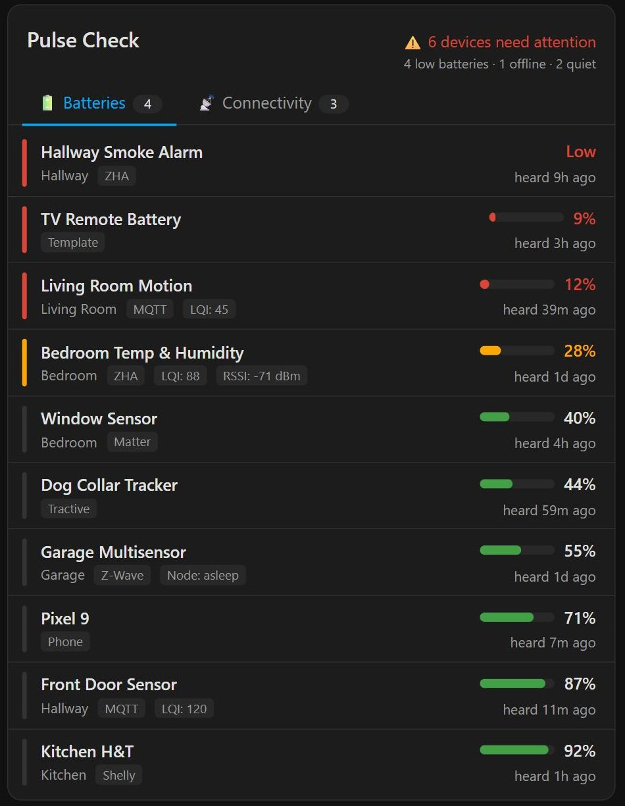
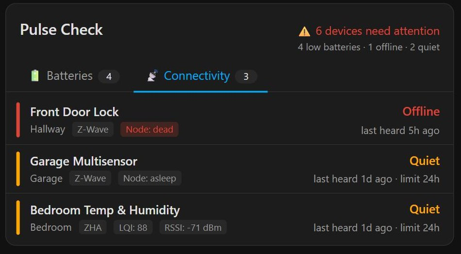

# Pulse Check Card

A device health card for [Home Assistant](https://www.home-assistant.io/): which devices are **low on battery**, which are **offline**, which have **gone quiet**, and what to do about it, across Zigbee, Z-Wave, Matter, Bluetooth, ESPHome, Shelly, Wi-Fi and the companion app.

It is the dashboard view of the [Pulse Check integration](https://github.com/yog18r/pulse-check-integration), which does the work: the integration runs the detection rules on the server around the clock, sends notifications, tracks battery replacements and estimates days left; the card shows that data and lets you act on it. **The card requires the integration.**

<p align="center">
  
  
</p>

<p align="center"><em>Rendered from the demo page with mock data. Dark and light HA themes.</em></p>

[](https://github.com/yog18r/pulse-check-card/actions/workflows/ci.yml)

---

## What it shows

- **🔋 Batteries**: every battery-powered device, lowest first (or soonest to run out), with a coloured bar, a trend sparkline, "~12d left", and a note when a battery is draining much faster than it used to
- **📡 Connectivity**: anything offline or not heard from within its threshold
- **🛠️ Actions** (optional tab): "Replace 2 × AA in Kitchen Mini Switch", "Charge Office Tablet", a to-buy total, and a **Done** button that records the replacement
- **Snooze** a device for 1, 7 or 30 days. Snoozes live in the integration, so every dashboard, phone and notification agrees
- **Group by** area, integration or device type
- Everything grouped by **device**, not entity, so each physical thing appears once. Tap a row to open it in Home Assistant

What counts as low, how long a device may stay quiet, which devices to ignore and which notifications to send are the integration's settings. The card's own options are about presentation only.

## Installation

1. Install the [Pulse Check integration](https://github.com/yog18r/pulse-check-integration) (HACS custom repository, or copy its folder) and add it under **Settings → Devices & services**.
2. Install the card:
   - **Manual**: download `pulse-check-card.js` from the [latest release](https://github.com/yog18r/pulse-check-card/releases/latest), copy it to `config/www/`, and add `/local/pulse-check-card.js` as a **JavaScript module** resource under **Settings → Dashboards → ⋮ → Resources**.
   - **HACS**: add this repository as a custom repository (category: Dashboard) and install it. HACS adds the resource for you.
3. Refresh the browser. "Pulse Check Card" appears in the card picker.

```yaml
type: custom:pulse-check-card
```

That is all you need. Without the integration the card says so instead of rendering.

## Configuration

Every option is about presentation and has a sensible default. The visual editor covers all of them.

```yaml
type: custom:pulse-check-card
title: Device Health # leave out for no title row
show_tabs: [batteries, connectivity, actions]
default_tab: batteries
max_rows: 12 # or "all"
battery_sort: level # or replace_soon
group_by: none # none, area, integration or device_type
problems_only: false # Batteries tab shows only warning/critical rows
show_sparklines: true
sparkline_days: 14 # 1 to 365
```

| Option            | Type    | Default                     | Notes                                                                     |
| ----------------- | ------- | --------------------------- | ------------------------------------------------------------------------- |
| `title`           | string  | none                        | Leave out (or blank) for no title row.                                    |
| `show_tabs`       | list    | `[batteries, connectivity]` | Any of `batteries`, `connectivity`, `actions`.                            |
| `default_tab`     | string  | `batteries`                 | Must be in `show_tabs`.                                                   |
| `max_rows`        | number  | `12`                        | Or `all`. A "show more" control reveals the rest.                         |
| `battery_sort`    | string  | `level`                     | `level` or `replace_soon` (fewest days left first, from the integration). |
| `group_by`        | string  | `none`                      | `none`, `area`, `integration` or `device_type`.                           |
| `problems_only`   | boolean | `false`                     | Batteries tab shows only warning/critical rows.                           |
| `show_sparklines` | boolean | `true`                      | Trend lines from recorder history, via the integration.                   |
| `sparkline_days`  | number  | `14`                        | 1 to 365.                                                                 |

Keys from older versions (`battery_warning`, `device_settings`, `exclude_*`, `quiet_*` and so on) are ignored: those settings now live in the integration.

### Per-device settings

The card's visual editor has a **Per-device settings** panel: pick any device (or a battery sensor that has no device), then set its display name, area, battery type and count, whether it is rechargeable, its quiet threshold and its notification policy. Each change is saved immediately through the integration's `pulse_check.set_device_settings` service, not into the card's YAML, so it applies everywhere: every card, the Actions tab's labels and shopping list, and the integration's notifications.

Thresholds, quiet rules, filters and notification targets are in the integration's own dialog: **Settings → Devices & services → Pulse Check → Configure**.

## How it works

The integration registers two websocket commands. The card subscribes to `pulse_check/subscribe` and receives a full snapshot immediately and again after every recompute (about two seconds after a relevant state change, and at least every five minutes): one entry per device with its battery, offline, quiet and severity facts, days left, the summary counts, the action list, the thresholds in force and the per-device settings. Sparklines come from `pulse_check/history`, which reads the recorder on the server. Snooze, unsnooze and Done are service calls; the next snapshot shows the result.

The browser never queries the recorder or analyses entities. A new `hass` object from Home Assistant does not re-render the card; only a new snapshot does.

Rows on the Batteries tab are coloured by the battery alone and rows on the Connectivity tab by connectivity alone, using the thresholds the integration sent, so the header (computed by the integration) and the rows can never disagree.

## Architecture

```
src/
├── core/
│   ├── types.ts            the wire shape (DeviceHealth) and the slice of hass the card reads
│   ├── sort.ts             ordering for the Batteries and Connectivity tabs
│   ├── grouping.ts         sections by area, integration or device type
│   ├── thresholds.ts       battery / connectivity severity for row colours
│   ├── summarise.ts        headline and breakdown text
│   ├── registryOptions.ts  device lists for the editor's picker
│   └── batteryTypes.ts     common battery sizes for the editor
├── card/
│   ├── config.ts           the presentation options, validated
│   ├── snapshot.ts         subscription, history and service calls
│   ├── PulseCheckCardElement.ts   the custom element HA talks to
│   └── PulseCheckCardEditor.ts    the visual editor element
└── ui/                     React components and hooks (useSnapshot, useHistory)
```

The custom element owns a shadow root and a React root. `useSnapshot` subscribes once per websocket connection and unsubscribes on unmount; `useHistory` fetches sparkline points for the batteries on screen and refreshes them every six hours.

## Development

```bash
npm install
npm run dev      # demo page with a fake subscription, no HA needed
npm run check    # typecheck, lint, format check, tests, build
```

Component tests (Testing Library) render the real React tree against a canned snapshot (`test/fixtures/snapshot.json`, 15 devices from the integration's test fixture) and check what a user sees and what the clicks send. The detection rules themselves are tested in the integration repo against a frozen golden file.

To try a build on a live instance, run `npm run build` and copy `dist/pulse-check-card.js` to `config/www/`, then hard-refresh the browser.

## Licence

MIT
